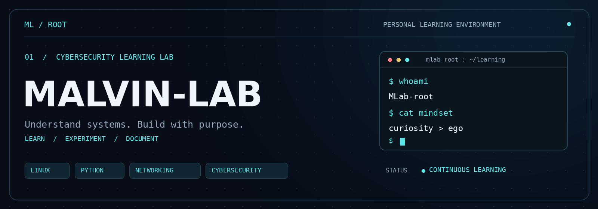

<p align="center">
  
</p>

<p align="center">
  
</p>
<h1 align="center">MALVIN-LAB</h1>
<p align="center"><strong>Linux · Python · Networking · Cybersecurity</strong></p>
<p align="center">Learning how systems work, how networks connect, and how to protect them.</p>
<p align="center">
  <a href="https://github.com/MLab-root?tab=repositories">Explore repositories</a>
  ·
  <a href="https://github.com/MLab-root">GitHub profile</a>
</p>

---

### 01 / Identity

```yaml
name: MALVIN-LAB
handle: MLab-root
focus: [Linux, Python, Networking, Cybersecurity]
status: learning and deepening my knowledge
mindset: curiosity, consistency, and responsible practice
```

I'm learning and deepening my understanding of Linux, Python, networking, and cybersecurity. My goal is to build strong fundamentals through hands-on practice and clear documentation.

### 02 / Learning focus

| Area | What I aim to understand |
| :--- | :--- |
| **Linux** | The command line, permissions, processes, and system administration. |
| **Python** | Programming fundamentals, automation, and practical scripting. |
| **Networking** | TCP/IP, DNS, routing, and how devices communicate. |
| **Cybersecurity** | Security fundamentals, system hardening, and responsible testing. |

### 03 / My approach

- **Understand the fundamentals** — learn what happens behind each command.
- **Practice with purpose** — use personal labs and authorized environments.
- **Document the process** — turn experiments and mistakes into useful notes.
- **Keep improving** — build consistency through small, deliberate steps.

### 04 / Explore the lab

My repositories are the place for my learning journey and future experiments.

**[Browse MLab-root's repositories →](https://github.com/MLab-root?tab=repositories)**

<!-- When you have public projects, add real repository links here.
Keep project descriptions specific: problem, what you built, and what you learned.
-->

---

<p align="center"><samp>UNDERSTAND SYSTEMS. BUILD WITH PURPOSE.</samp></p>
